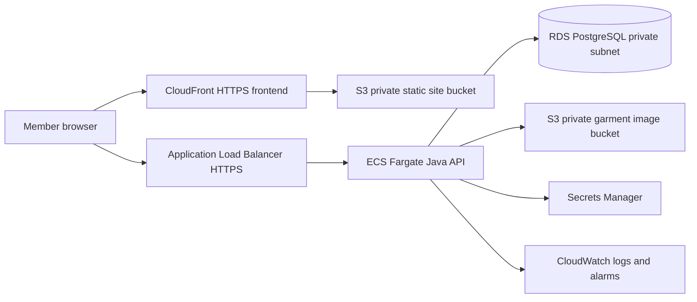

# Closet Cycle cloud architecture

## Proposed production-like deployment

The API is stateless and can scale horizontally. RDS stores users, listings, exchange state, and the credit ledger. The production deployment must replace local file storage with private S3 and use IAM task roles; do not mount a container-local upload directory in production. TLS terminates at the load balancer and CloudFront. RDS is private; only the API security group can reach its port. The Terraform in `infra/aws` is a starting point that needs account-specific review and does not claim a deployment.

## Reliability and security controls

- Keep application tasks in subnets with no inbound rule except from the ALB security group. Keep the database in private subnets and permit only the API security group.
- Use task roles with the least privilege required for S3 objects and CloudWatch logs. Store DB password and JWT secret in Secrets Manager; never place real values in source control or image layers.
- Keep S3 buckets private with block-public-access enabled, object encryption enabled, and lifecycle cleanup for abandoned uploads.
- Require HTTPS in public endpoints. Use RDS automated backups, deletion protection for production, and a documented restore test.
- Send structured application logs to CloudWatch. The current infrastructure alarm covers unhealthy targets; add 5xx, high CPU/memory, and low database storage alarms before a public pilot. Enable ALB access logs if the team needs request-level diagnostics.
- Pin reviewed dependency versions, scan images/dependencies in CI, and rotate credentials after any suspected disclosure.

## CI/CD and deployment procedure

The GitHub Actions workflow runs frontend build and Java tests on pull requests and pushes. A team-owned deployment workflow should publish immutable images and static artifacts after a reviewed main-branch merge. Configure repository secrets and AWS OIDC role trust outside the repository; do not use long-lived AWS access keys. Apply Terraform only after the team reviews its plan, account, region, estimated monthly cost, and cleanup plan.

## Backup, restore, and recovery

Set RDS backups to a retention period approved by the team, enable deletion protection for a production database, and test restoring a snapshot into an isolated database before launch. Export a daily encrypted database snapshot for the pilot if required by the assignment. Image objects need versioning/lifecycle policy and a restore/delete procedure. Define a pilot recovery objective with the instructor; no RPO/RTO has been measured yet.

## Cost model assumptions

The report must be refreshed in AWS Pricing Calculator for the exact region, runtime, and student-credit eligibility before deployment. The model below is a planning estimate, not a quote. It assumes Linux x86 Fargate, 0.25 vCPU/0.5 GiB per task, one task for the pilot, a small single-AZ PostgreSQL instance for class demonstration, one public ALB, modest S3 storage and requests, CloudWatch logs, and no paid support. It excludes taxes, data transfer spikes, NAT gateways, domain registration, support, and student-credit offsets. A multi-AZ database and redundant tasks cost more.

| Monthly audience scenario | Active API tasks | Data assumptions | Planning range (USD/month) |
| --- | ---: | --- | ---: |
| 100 users | 1 | 25 GB images, 20 GB egress | $70–$180 |
| 1,000 users | 2 | 250 GB images, 200 GB egress | $150–$450 |
| 10,000 users | 4–8 | 2.5 TB images, 2 TB egress | $500–$2,000+ |

Ranges include always-on baseline services and are intentionally broad; they are placeholders pending a calculator run with actual traffic and region. AWS bills Fargate by allocated compute/memory duration, RDS by instance/storage/backup usage, and S3 by storage, requests, and transfer. Check the official [Fargate pricing](https://aws.amazon.com/fargate/pricing/), [RDS for PostgreSQL pricing](https://aws.amazon.com/rds/postgresql/pricing/), and [S3 pricing](https://aws.amazon.com/s3/pricing/) pages. Set a monthly budget alert before provisioning, and destroy lab resources after evaluation.
