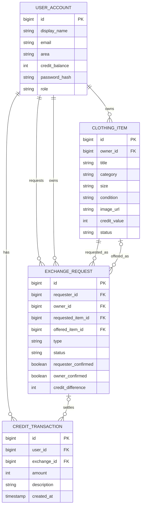

# Closet Cycle final project report

## Executive summary

Closet Cycle is a campus-first clothing exchange prototype that helps members list wearable clothes and exchange them through direct swaps or an internal credit balance. The project combines a responsive React interface with a Java 25 LTS/Spring Boot API, relational persistence, authenticated member actions, image upload paths, and a two-party completion flow. This repository also contains a test package, AWS deployment infrastructure source, startup analysis, risk/compliance checklist, and a 12-slide pitch script.

The prototype builds successfully and has passed 18 Java API integration tests, frontend type checking and production bundling, Terraform configuration validation, and a local API smoke check. It is ready for team review and instructor demonstration. No AWS deployment, user study, measured environmental impact, or commercial launch is claimed in this report.

## 1. Problem and opportunity

The project hypothesis is that students have wearable clothes they no longer use, while finding an affordable replacement or arranging a fair direct swap takes effort. A campus boundary may make discovery and handover simpler than a broad marketplace. These assumptions still require consented interviews and a live pilot. The project deliberately avoids claiming a measured waste or emissions benefit.

## 2. Proposed solution and MVP

The UI supports a landing experience, browse/search/filter, listing detail, sign-in and registration, listing creation/editing, member wardrobe, exchange management, wallet, profile, and safety/help content. It now also includes a Closet Cycle Pro pricing and simulated checkout preview with selectable UPI, card, and net-banking options. The demo activation only stores a browser flag; no payment details are collected and no money is charged. The Java API supports member accounts, clothing listings, image upload, exchange request and state transitions, and credit history. Credits cannot be purchased or withdrawn. The product does not provide shipping or choose a meetup location for members.

The full member flow is: create an account, list a garment, request another member’s listing, let the owner accept or decline, arrange a safe handover, then have both participants confirm. Credits and listing status settle only after both confirmations.

## 3. Technical implementation

The web interface uses React, TypeScript, and Vite. The service uses Java 25 LTS and Spring Boot with Spring Security, signed JWT authentication, BCrypt password hashes, validation, Spring Data JPA, Flyway migrations, and H2 locally or PostgreSQL in the container/cloud configuration. Domain objects include `UserAccount`, `ClothingItem`, `ExchangeRequest`, `CreditTransaction`, and listing reports. Members can report another member's listing; moderator-only endpoints list and resolve or dismiss reports. `AuditedEntity` demonstrates inheritance; repository and notification contracts use interfaces; domain exceptions map invalid actions to API responses; a bounded Spring executor sends asynchronous exchange notifications. Row locks protect exchange state and credit settlement.

Local uploads are stored on the filesystem. The production profile uses private S3 storage through an IAM task role, and images are served through a constrained media endpoint. The Terraform source proposes CloudFront for the frontend and HTTPS at the API load balancer, ECS Fargate for the API, isolated RDS PostgreSQL, S3 media, CloudWatch, scaling, and a budget email alert.

## 4. Data model

## 5. Testing and quality

The Java integration suite contains tests for public browse, combined filters, authentication, duplicate registration, listing authorization and validation, ownership, exchange progression, two-party settlement, insufficient credits, and participant checks. The plan adds cases for uploads, expired/tampered tokens, concurrent requests, mobile layout, keyboard and screen reader use, performance, backup/restore, and deployed smoke tests. It has more than 30 documented cases across automated and manual categories.

The test execution log records 18 passing Java API integration tests (0 failures, 0 errors), successful TypeScript checking and production bundling, Terraform validation, and a local API smoke check for health, browse, sign-in, private listings, and wallet balance. No coverage percentage is claimed. Docker, performance, penetration, accessibility, field usability, backup/restore, and deployed smoke tests remain outstanding. The first team deployment must record its own output and triage any defects.

## 6. Cloud operations and cost

The proposed AWS setup keeps the database private, restricts database ingress to the API security group, limits API ingress to the load balancer, uses private encrypted image storage, and keeps credentials in Secrets Manager. CI runs frontend build and backend tests. Health checks and an unhealthy-target alarm are configured in source. A budget email notification is a warning only; it does not cap spending.

The reported planning ranges are $70–$180/month for 100 members, $150–$450/month for 1,000, and $500–$2,000+/month for 10,000, under the assumptions documented in `ARCHITECTURE.md`. These are not calculator results or guaranteed prices. Obtain approval and refresh a regional calculator estimate before creating resources. The database is single-AZ for the student pilot and should be reviewed for any production use.

## 7. Startup, business, and compliance

The initial business hypothesis keeps core exchanges free. A proposed Pro tier at illustrative prices of ₹49/month or ₹399/year could later provide more listing capacity, saved searches and match alerts, optional listing spotlight controls, and a personal exchange summary. Campus swap-event sponsorship is another hypothesis. These prices and features are not validated; there is no current revenue or live payment processing. Go-to-market hypotheses include campus sustainability groups, orientation events, and student ambassadors. Pilot metrics should include listings per active member, match and completion rates, time-to-match, repeat use, report rate, cost per completed exchange, and willingness to pay for optional features.

The Lean Canvas, Business Model Canvas, SWOT, PESTEL, revenue assumptions, funding sequence, DPIIT/IP readiness, safety, privacy, consent, and e-commerce checklist are in `PROJECT_DELIVERABLES.md`, `ECOMMERCE_DESIGN.md`, and `STARTUP_READINESS.md`. A draft topic proposal, source-matched UML class diagram, and consent-first user research plan are also included. Before launch, the team needs actual terms, privacy and data-retention behavior, a moderator response process, rights-cleared images, local legal review, and a defined deletion/contact flow. DPIIT recognition, incorporation, trademark rights, legal review, and grant eligibility are not asserted.

## 8. Presentation and handoff

`PITCH_DECK.md` contains a 12-slide investor/semester story with notes. `DEMO_SCRIPT.md` times a five-minute walkthrough. Add the course, institution, team members, instructor, actual user feedback, actual test results, the live deployment URL and screenshots, a cost calculator export, and the recorded demo. During the presentation, distinguish prototype code, planned cloud configuration, and demonstrated results.

## 9. Known gaps and next work

1. Add agreed code coverage reporting and broaden automated coverage for uploads, moderator flows, and UI components.
2. Complete accessibility, usability, security, concurrency, performance, and backup/restore checks with evidence.
3. Build and push the API container, review/apply the Terraform plan in an approved account, deploy the frontend, verify HTTPS/CORS/S3/DB/alerts, and capture the public smoke test.
4. Assign and train a moderator to review reports, define response times and appeals, and add account suspension/content removal plus an audit trail before a public pilot.
5. Have the team/instructor review policy, legal, funding, DPIIT, intellectual property, and local compliance items.
6. Record and rehearse the five-minute demo and 10–12 slide presentation with real team data.
