# Closet Cycle UML class diagram

This class diagram reflects the Java source structure. It is a design view of the implemented prototype, not a claim that every external operational control is deployed.

```mermaid
classDiagram
    class AuditedEntity {
      <<abstract>>
      +Long id
      +Instant createdAt
      +Instant updatedAt
    }
    class UserAccount {
      +String displayName
      +String email
      +String passwordHash
      +String area
      +int creditBalance
      +UserRole role
    }
    class ClothingItem {
      +String title
      +String category
      +String size
      +String conditionLabel
      +String imageUrl
      +int creditValue
      +ItemStatus status
    }
    class ExchangeRequest {
      +ExchangeType type
      +ExchangeStatus status
      +boolean requesterConfirmed
      +boolean ownerConfirmed
      +int creditDifference
    }
    class CreditTransaction {
      +int amount
      +String description
    }
    class MemberReport {
      +String reason
      +String details
      +String status
    }
    class AuthController
    class ClothingController
    class ExchangeController
    class WalletController
    class MemberReportController
    class AuthService
    class ClothingService
    class ExchangeService
    class UserService
    class MemberReportService
    class UserRepository {
      <<interface>>
    }
    class ClothingItemRepository {
      <<interface>>
    }
    class ExchangeRepository {
      <<interface>>
    }
    class CreditTransactionRepository {
      <<interface>>
    }
    class MemberReportRepository {
      <<interface>>
    }
    class ImageStorageService {
      <<interface>>
      +store(file) String
      +load(key) Resource
    }
    class LocalFileStorageService
    class S3ImageStorageService
    class NotificationService {
      <<interface>>
      +notifyUser(userId, message)
    }
    class AsyncNotificationService
    class InsufficientCreditsException
    class InvalidExchangeException
    class InvalidUploadException
    class ResourceNotFoundException
    class UserRole {
      <<enumeration>>
      MEMBER
      MODERATOR
    }
    class ItemStatus {
      <<enumeration>>
      AVAILABLE
      RESERVED
      EXCHANGED
      ARCHIVED
    }
    class ExchangeType {
      <<enumeration>>
      DIRECT_SWAP
      CREDITS
    }
    class ExchangeStatus {
      <<enumeration>>
      REQUESTED
      ACCEPTED
      ARRANGED
      COMPLETED
      REJECTED
      CANCELLED
    }

    AuditedEntity <|-- UserAccount
    AuditedEntity <|-- ClothingItem
    AuditedEntity <|-- ExchangeRequest
    AuditedEntity <|-- CreditTransaction
    AuditedEntity <|-- MemberReport
    UserAccount --> UserRole
    ClothingItem --> ItemStatus
    ExchangeRequest --> ExchangeType
    ExchangeRequest --> ExchangeStatus

    UserAccount "1" --> "0..*" ClothingItem : owns
    UserAccount "1" --> "0..*" ExchangeRequest : requests
    UserAccount "1" --> "0..*" ExchangeRequest : owns listing for
    ClothingItem "1" --> "0..*" ExchangeRequest : requested item
    ClothingItem "0..1" --> "0..*" ExchangeRequest : offered item
    UserAccount "1" --> "0..*" CreditTransaction : ledger
    ExchangeRequest "0..1" --> "0..*" CreditTransaction : settles
    ClothingItem "1" --> "0..*" MemberReport : receives
    UserAccount "1" --> "0..*" MemberReport : files

    AuthController --> AuthService
    ClothingController --> ClothingService
    ExchangeController --> ExchangeService
    WalletController --> UserService
    MemberReportController --> MemberReportService
    AuthService --> UserRepository
    ClothingService --> ClothingItemRepository
    ExchangeService --> ExchangeRepository
    ExchangeService --> CreditTransactionRepository
    ExchangeService --> NotificationService
    MemberReportService --> MemberReportRepository
    ClothingService --> ImageStorageService
    ImageStorageService <|.. LocalFileStorageService
    ImageStorageService <|.. S3ImageStorageService
    NotificationService <|.. AsyncNotificationService
    ExchangeService ..> InsufficientCreditsException : raises
    ExchangeService ..> InvalidExchangeException : raises
    ClothingService ..> InvalidUploadException : raises
    ClothingService ..> ResourceNotFoundException : raises
```

## Design notes

- `AuditedEntity` provides shared identity and timestamp fields to the persisted domain entities.
- Controllers expose HTTP endpoints; services own application rules; Spring Data repositories persist domain records.
- `ImageStorageService` keeps local filesystem and S3 implementations interchangeable.
- `NotificationService` separates notification behavior from exchange rules; its current implementation is asynchronous.
- Exchange settlement uses transactional service logic and repository locking. See the integration tests for demonstrated flows and the test plan for outstanding concurrency validation.
